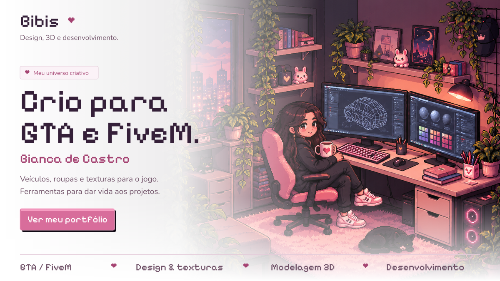
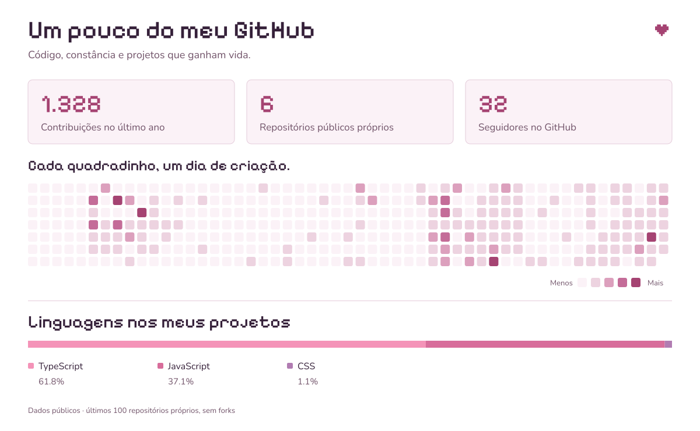
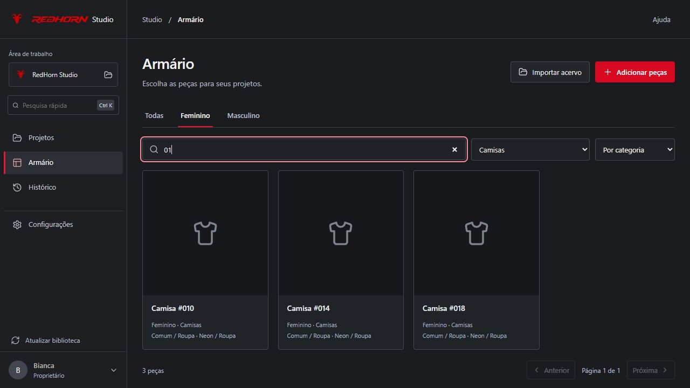
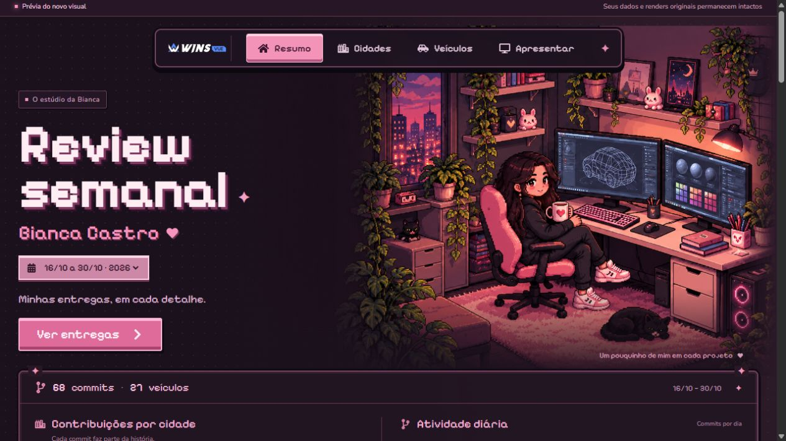

<a href="https://bianca-castro-portfolio.cuddlyibex65.chatgpt.site">
  <picture>
    <source media="(prefers-color-scheme: dark)" srcset="./assets/generated/hero.png" />
    <source media="(prefers-color-scheme: light)" srcset="./assets/generated/hero-light.png" />
    
  </picture>
</a>

Sou **Bianca de Castro**, também conhecida como **Bibis**. Desenvolvo aplicações Full Stack e trabalho com veículos, roupas, plotagens e texturas para GTA / FiveM.

**No meu dia a dia:** JavaScript, TypeScript, Node.js, React, Next.js, MongoDB, Blender e Photoshop.

### Um pouco do meu GitHub

<picture>
  <source media="(prefers-color-scheme: dark)" srcset="./assets/generated/activity.png" />
  <source media="(prefers-color-scheme: light)" srcset="./assets/generated/activity-light.png" />
  
</picture>

### Ferramentas que eu crio

| RedHorn Studio | Wins Review |
| :--- | :--- |
|  |  |
| Organização de peças, texturas e projetos para GTA / FiveM. | Histórico de trabalho, acompanhamento e revisão de entregas. |

  <a href="https://bianca-castro-portfolio.cuddlyibex65.chatgpt.site">Conheça meu portfólio</a> ·
  <a href="https://github.com/biancadcastro?tab=repositories">Meus repositórios</a>

