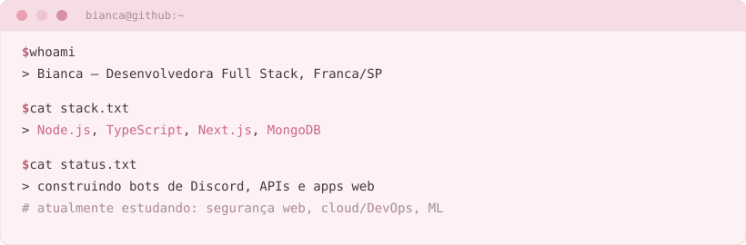

<div align="center">
  
</div>

<p align="center" style="margin-top: 20px;">
  
</p>


<table align="center">
  <tr>
    <td>
      
    </td>
    <td>
      
    </td>
  </tr>
</table>

<br>


```
bibis-links/          # TypeScript — página de links pessoal
juridico-cdanjos/      # TypeScript
Bot-KL4/               # JavaScript — bot de moderação da KL4
Hope-Bot/              # JavaScript — bot para o servidor Hope GTA-RP
isDecimal/             # JavaScript
```

<br>

<details>
<summary>🇺🇸 read in english</summary>

<br>

**whoami** — Bianca, full-stack developer based in Franca, São Paulo, Brazil.

**stack** — Node.js, TypeScript, Next.js, MongoDB, Docker.

**status** — building Discord bots, APIs and web apps. Currently learning web security, cloud/DevOps and ML.

**projects**
- `bibis-links` — personal links page (TypeScript)
- `juridico-cdanjos` (TypeScript)
- `Bot-KL4` — moderation bot for KL4 (JavaScript)
- `Hope-Bot` — bot for the Hope GTA-RP server (JavaScript)
- `isDecimal` (JavaScript)

</details>

<p align="center"><sub>feito com ❤️ e ☕ por <a href="https://github.com/biancadcastro">Bianca</a></sub></p>
